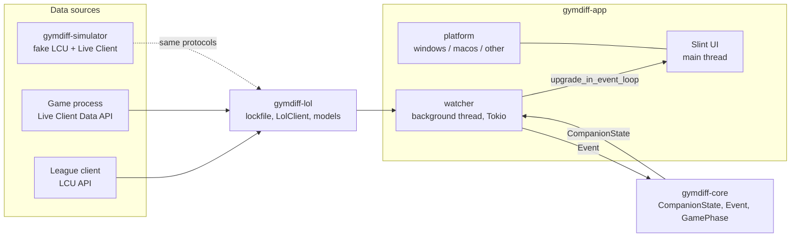

# Architecture overview

## Crates

| Crate | Responsibility | May depend on |
|---|---|---|
| `gymdiff-core` | Domain types and logic. Pure functions, reducer `CompanionState::apply(Event)`. | `serde` only |
| `gymdiff-lol` | League local APIs: lockfile discovery, `LolClient` trait, HTTP client, API models. | `gymdiff-core`, `reqwest` |
| `gymdiff-simulator` | Fake League client replaying scenarios (development only, never shipped). | `gymdiff-lol` (lockfile format), `axum` |
| `gymdiff-diagnostics` | Opt-in reports: consent and scrubbing. No network. See [[ADR-0006 Opt-in error reports]]. | `serde`, `regex` |
| `gymdiff-app` | The shipped binary (`gymdiff.exe`): Slint UI, watcher, OS integration. | everything above, `slint` |

## Rules
1. **Core is pure.** No I/O, no `#[cfg(target_os)]`, no async. If it can't be unit-tested on any machine, it doesn't belong in core.
2. **One way in.** The app reads game data only through the `LolClient` trait. The real client and the simulator speak the same protocols, so the code path is identical in development and production.
3. **OS code is fenced.** Everything platform-specific lives in `gymdiff-app/src/platform/`. Each platform module exposes the same functions; macOS may stub Windows-only behaviour.
4. **State flows one way.** Data source → `Event` → reducer → `CompanionState` → UI. The UI never calls the network.

## Threading
- **Main thread**: Slint event loop. Never block it.
- **`watcher` thread**: a multi-threaded Tokio runtime. Discovers the client, polls it, reduces events, pushes state to the UI with `slint::Weak::upgrade_in_event_loop`.

## Discovery and connection
1. Find the lockfile: `GYMDIFF_LOCKFILE`, then the platform default path (see [[League APIs]]).
2. Build an `HttpLolClient` from it (LCU base URL + password).
3. Poll every second. After 3 consecutive LCU failures, assume the client closed and go back to step 1.

## TLS
`reqwest` is built with `native-tls` (Schannel on Windows, Security.framework on macOS). This keeps the Windows build free of C build steps, so `cargo check --target x86_64-pc-windows-msvc` works from macOS.

The local APIs use certificates signed by Riot's own root CA. For now the client accepts any certificate (it only ever contacts `127.0.0.1`); trusting `riotgames.pem` explicitly is on the [[Roadmap]].

## Logging
`tracing`, to stderr (no console on Windows release builds, which are GUI apps) and to a daily-rotated file:
- Windows: `%LOCALAPPDATA%\GymDiff\logs\`
- macOS: `~/Library/Logs/GymDiff/`

Local logs stay on the PC. Sending to Sentry is **opt-in**, one switch per product ([[ADR-0006 Opt-in error reports]], [[Privacy]]); `gymdiff-app/src/reporting.rs` does it, only with consent and a DSN:

| Level | Local file | Sentry |
|---|---|---|
| `ERROR` | yes | **Issue** ("Send crash reports") + Log |
| `WARN`, `INFO` | yes | Log ("Send all logs") |
| `DEBUG` | yes (GymDiff crates) | never |
| `TRACE` | only with `RUST_LOG` | never |

Filter with `RUST_LOG` (default: `info,gymdiff=debug,gymdiff_lol=debug`). Which level to use: [[Logging]].

## Configuration (environment variables)
Variables can live in a git-ignored `.env` at the repository root (template: `.env.example`); `just` recipes load it, plain `cargo run` does not.

| Variable | Used by | Purpose |
|---|---|---|
| `GYMDIFF_LOCKFILE` | app | Lockfile path (the simulator writes one in `target/simulator/`) |
| `GYMDIFF_LIVE_CLIENT_URL` | app | Live Client Data base URL (default `https://127.0.0.1:2999`) |
| `GYMDIFF_DATA_DIR` | app | Settings folder (default `%APPDATA%\GymDiff\` on Windows, `~/Library/Application Support/GymDiff/` on macOS). Point it at an empty folder to see the welcome screen again |
| `GYMDIFF_SCENARIO` | simulator | Scenario to replay |
| `GYMDIFF_SENTRY_DSN` | app | Sentry DSN for opt-in reports (run time, else build time; unset = reports off) |
| `GYMDIFF_TEST_CRASH` | app | Fires a test event at start: `error`, `panic`, `stack-overflow`… (see [[Releasing]]) |
| `GYMDIFF_CHANNEL` | app build | `release`, `alpha` or `preview`, set by CI; unset = `development` ([[ADR-0008 Versioning and releases]]) |
| `RUST_LOG` | both | Log filter |
| `GYMDIFF_WIN_HOST`, `GYMDIFF_WIN_REPO` | justfile | Windows PC over SSH (see [[Windows testing]]) |
