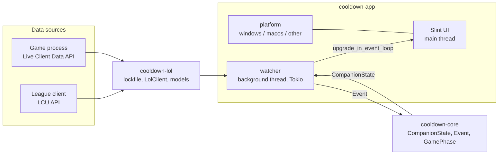

# Architecture overview

## Crates

| Crate | Responsibility | May depend on |
|---|---|---|
| `cooldown-core` | Domain types and logic. Pure functions, reducer `CompanionState::apply(Event)`. | `serde` only |
| `cooldown-lol` | League local APIs: lockfile discovery, `LolClient` trait, HTTP client, API models. | `cooldown-core`, `reqwest` |
| `cooldown-diagnostics` | Opt-in reports: consent and scrubbing. No network. See [[ADR-0006 Opt-in error reports]]. | `serde`, `regex` |
| `cooldown-shortcuts` | cooldown.lol's Start menu and Desktop shortcuts and its startup entry on Windows (create, remove, exists), and where Velopack installed it. See [[ADR-0012 Installer window in Slint over Velopack]], [[ADR-0013 Notification area, startup and uninstall from the app]]. | `dirs`, `mslnk`, `winreg` (Windows only) |
| `cooldown-app` | The shipped binary (`cooldown.exe`): Slint UI, watcher, OS integration, updates (Velopack). | everything above, `slint`, `velopack` |
| `cooldown-installer` | The installer window (`cooldown.lol-<channel>-Setup.exe`): shortcut and startup choices, then Velopack's setup it embeds. Its UI files live in `cooldown-app/ui/`. | `cooldown-shortcuts`, `slint` |

## Rules
1. **Core is pure.** No I/O, no `#[cfg(target_os)]`, no async. If it can't be unit-tested on any machine, it doesn't belong in core.
2. **One way in.** The app reads game data only through the `LolClient` trait. The League client is the same on macOS and Windows, so the code path is identical in development and production.
3. **OS code is fenced.** Everything platform-specific lives in `cooldown-app/src/platform/`. Each platform module exposes the same functions; macOS may stub Windows-only behaviour.
4. **State flows one way.** Data source → `Event` → reducer → `CompanionState` → UI. The UI never calls the network.

## Threading
- **Main thread**: Slint event loop. Never block it.
- **`watcher` thread**: a multi-threaded Tokio runtime. Discovers the client, polls it, reduces events, pushes state to the UI with `slint::Weak::upgrade_in_event_loop`.
- **`single-instance` thread**: listens on a local socket (a named pipe on Windows) for a second cooldown.lol asking to show the window ([[Running in the background]]).
- The **notification area icon** lives on the main thread (it needs the event loop); its clicks are handed back to the event loop. Closing the window hides it: the event loop runs until **Quit cooldown.lol** ([[ADR-0013 Notification area, startup and uninstall from the app]]).

## Discovery and connection
1. Find the lockfile: `COOLDOWN_LOCKFILE`, then the platform default path (see [[League APIs]]).
2. Build an `HttpLolClient` from it (LCU base URL + password).
3. Poll every second. After 3 consecutive LCU failures, assume the client closed and go back to step 1.

## TLS
`reqwest` is built with `native-tls` (Schannel on Windows, Security.framework on macOS). This keeps the Windows build free of C build steps, so `cargo check --target x86_64-pc-windows-msvc` works from macOS.

The local APIs use certificates signed by Riot's own root CA. For now the client accepts any certificate (it only ever contacts `127.0.0.1`); trusting `riotgames.pem` explicitly is on the [[Roadmap]].

## Logging
`tracing`, to stderr (no console on Windows release builds, which are GUI apps) and to a daily-rotated file:
- Windows: `%LOCALAPPDATA%\cooldown.lol\logs\`
- macOS: `~/Library/Logs/cooldown.lol/`

Local logs stay on the PC. Sending to Sentry is **opt-in**, one switch per product ([[ADR-0006 Opt-in error reports]], [[Privacy]]); `cooldown-app/src/reporting.rs` does it, only with consent and a DSN:

| Level | Local file | Sentry |
|---|---|---|
| `ERROR` | yes | **Issue** ("Send crash reports") + Log |
| `WARN`, `INFO` | yes | Log ("Send all logs") |
| `DEBUG` | yes (cooldown.lol crates) | never |
| `TRACE` | only with `RUST_LOG` | never |

Filter with `RUST_LOG` (default: `info,cooldown=debug,cooldown_lol=debug`). Which level to use: [[Logging]].

## Configuration (environment variables)
Variables can live in a git-ignored `.env` at the repository root (template: `.env.example`); `just` recipes load it, plain `cargo run` does not.

| Variable | Used by | Purpose |
|---|---|---|
| `COOLDOWN_LOCKFILE` | app | Lockfile path, for a League client installed outside the default folders |
| `COOLDOWN_DATA_DIR` | app | Settings folder (default `%APPDATA%\cooldown.lol\` on Windows, `~/Library/Application Support/cooldown.lol/` on macOS). Point it at an empty folder to see the welcome screen again |
| `COOLDOWN_SENTRY_DSN` | app | Sentry DSN for opt-in reports (run time, else build time; unset = reports off) |
| `COOLDOWN_TEST_CRASH` | app | Fires a test event at start: `error`, `panic`, `stack-overflow`… (see [[Releasing]]) |
| `COOLDOWN_CHANNEL` | app build | `release`, `alpha` or `preview`, set by CI; unset = `development` ([[ADR-0008 Versioning and releases]]) |
| `RUST_LOG` | app | Log filter |
| `COOLDOWN_WIN_HOST`, `COOLDOWN_WIN_REPO` | justfile | Windows PC over SSH (see [[Windows testing]]) |
