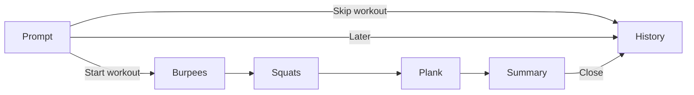

# Post-game workout

The MVP feature. When a Summoner's Rift game ends, GymDiff shows the role's key stats and the workout they convert into, computed with the [[Workout formula]].

## User story
As a player who just finished a game, I want to see right away how many burpees, squats and seconds of plank I owe, and why, so that I do them before queuing again.

## Why
Turns the dead time between games into a workout, and gives the end-of-game stats a consequence (see [[Vision]]).

## Scope
- Queues on Summoner's Rift: ranked solo/duo, ranked flex, normal draft, normal blind, swiftplay.
- Out of scope for the MVP: ARAM, rotating modes, arena, custom games, practice tool, bot games, spectator.
- No overlay: nothing is shown during the game.

## Behaviour

### Window by phase
There is no Workout screen: the main screen is [[History]], and the workout is a **modal** over it.

| Client phase | What the window shows |
|---|---|
| No client / idle / lobby / queue / champ select | [[History]]. Before the first game: its empty state. |
| In game (`GameStart`, `InProgress`, `Reconnect`) | Same. Nothing new appears during the game. |
| `WaitingForStats`, `PreEndOfGame` | History, with a "Game over · Computing your workout…" card on top of the current session. No modal yet. |
| `EndOfGame`, workout ready | The **workout prompt** opens on its own over History. The game's card in History shows *Pending*. |
| `EndOfGame`, no workout (remake, mode out of scope, role not detected, stats unreadable) | No modal. The game's card in History shows "No workout" and the reason (see [[#Edge cases]]). |

### Workout modal
The workout opens in two parts: a **prompt**, then, once started, the **steps** in a sheet.

#### Prompt ("Workout ready")
Works like a matchmaking "match found" prompt: one obvious action, readable at a glance.
- Opens **on its own** once per game, as soon as the workout is computed (from About, the app goes back to History first). **Start** on the game's pending card in History also reopens it.
- A centred dialog over a dimmed window (top bar included).
- Content, top to bottom:
  - "WORKOUT READY" in `accent`;
  - played and linked champion portraits ([[Champion portraits]]), Victory / Defeat, "Champion · Role · with <linked champion>";
  - a **big round "START WORKOUT" button** (`accent`, inside a faint halo) — the only primary action;
  - what is due, one item per exercise with its pictogram: burpees, squats, plank seconds (e.g. "6 · 21 · 60s"); an exercise with 0 due is dimmed;
  - two text actions: **Later** (closes the prompt, the workout stays *Pending*) and **Skip workout** (every exercise recorded as 0 done, status *Skipped*);
  - "Listen to your body. Skip anything that hurts." (no health claim).
- No countdown: the prompt waits for the player.
- There is no overview screen: why each number is due (stat, actual value, target, cap) is shown in each step and in the expanded History card ([[History#Workout cards]]).

#### Steps
- After **Start workout**, the steps open as a sheet over History: full width, from under the top bar to the bottom of the window, over a dimmed History; header "POST-GAME WORKOUT" and a close button (×). See [[Screens#Layout]].
- **Close (×)** at any step: the steps already recorded are kept, the workout stays *Pending*, and Start on its card reopens the prompt; Start workout then resumes at the step where it was left. Closing during the plank countdown pauses it.
- The summary's **Close** closes the sheet; the History card then shows the workout's status.
- Only one workout can be pending: when the next workout is ready, the pending one is closed (unfinished steps recorded as 0, see [[#Interruptions]]).

### Workout flow

Steps come in this order: **Burpees** (role's main stat), **Squats** (role's secondary stat), **Plank** (deaths). Which stats feed burpees and squats depends on the role, see [[Workout formula]].

Each exercise has its own **pictogram** (burpee, squat, plank: Pencil components `Exercise icon / *`), shown next to its name everywhere it appears: prompt, step title (large), summary rows, History strips, Welcome screen. Always in `text-primary`. Sizes: 16, 28 and 56 px (one component per size, `Exercise icon / <Exercise> / <size>`).

Exercises with 0 to do have no step (dimmed in the prompt, "0, target reached" in the summary).

#### Rep step (burpees, squats)
- Progress: "Step 1 of 3" and one dot per step.
- The exercise name, why it is due (stat, its value in `danger` under target, target, and "capped at N" when a cap applied), and the **number done**, prefilled with the number due.
- **−** and **+** buttons change the number done, between 0 and the number due.
- **Done** records the number shown and goes to the next step. **Skip** records 0 and goes to the next step.
- **Back** returns to the previous step (its recorded number stays editable). Not shown on the first step.

#### Plank step (countdown)
| State | Shows | Actions |
|---|---|---|
| Ready | The seconds due, big | **Start**, Skip |
| Get ready | 3, 2, 1 | — (Pause cancels back to Ready) |
| Running | Remaining seconds counting down, progress ring | **Pause** |
| Paused | Remaining seconds frozen | **Resume**, **Stop here** (records the seconds held so far) |
| Finished (0 s) | A short sound, then the summary | — |

- Seconds held are recorded as the plank's number done.
- The countdown runs only while the modal is open: closing the modal pauses it (state Paused when reopened).

#### Summary
- Done vs. due per exercise, e.g. "18 / 21 squats", in `success` when complete and `warning` when partial.
- The workout status: **Done** (everything complete), **Partial** (something below due), **Skipped** (nothing done).
- The session total highlighted.
- **Close** (primary): closes the modal, History is behind it.

#### Interruptions
- If the next workout is ready while one is unfinished (modal open or closed), the unfinished steps are recorded as 0 and the new workout replaces it. A game without a workout (remake, …) does not close the pending one.
- If GymDiff quits during a workout, the steps already recorded are kept and the rest count as 0.

### Edge cases
| Situation | Behaviour |
|---|---|
| Remake (< 5 min or flagged by the client) | No modal. History card "No workout · Remake". Not counted in the session. |
| Mode out of scope (ARAM, arena, …) | No modal. History card "No workout · This mode isn't covered yet". Not counted. |
| Role not detected (no source below gives a position) | No modal. History card "No workout · Couldn't detect your role". Not counted. Logged with the payloads. The player is never asked. |
| End-of-game stats unavailable (endpoint missing, malformed payload) | No modal. History card "No workout · Couldn't read the end-of-game stats". Nothing counted. Logged with the payload. |
| Player leaves the end-of-game screen before stats arrive | Keep trying while the client is connected; if the stats never arrive, same as above. |
| GymDiff started while already on the end-of-game screen | Compute the workout and open the modal normally. |
| Same game seen twice (polling) | Counted once (keyed by game id). |
| Every handled or unhandled game | Saved to [[History]]. |
| Client closes after the game | The modal and History stay as they are. |

### Window and attention
- The workout modal opens inside the GymDiff window (see [[Screens]]); GymDiff does **not** steal focus from the League client and does not bring its window to the front.
- Proposal: flash the taskbar button on Windows when a new workout is ready (macOS: no-op stub).

## Data
- **Phase**: LCU `GET /lol-gameflow/v1/gameflow-phase` (already used by [[Client status]]).
- **End-of-game stats**: LCU `GET /lol-end-of-game/v1/eog-stats-block`, available around `EndOfGame`. Expected content: game id, game length, queue type, game mode, and per team the players with their stats (kills, deaths, assists, minions, neutral minions, damage to champions, vision score) and the winning team. **Field names to confirm with a recorded payload** from the Windows PC.
- **Role**, detected from the data only, first source that gives a position wins (same sources give the allies' positions for [[Champion portraits]]):
  1. End-of-game stats → position of each player, if the payload has one (expected `detectedTeamPosition`, **to confirm** with a recorded payload). Covers blind pick too.
  2. LCU `GET /lol-champ-select/v1/session` during champion select → `myTeam[].assignedPosition` (ranked, draft); remembered until the game ends.
  3. Live Client Data `GET /liveclientdata/playerlist` during the game → `position` of each player; the last value seen is remembered.
  4. LCU `GET /lol-match-history/v1/games/{gameId}` after the game → the position Riot computed (field **to confirm**).
- **Queue / mode** to check the scope: from the end-of-game stats, or LCU `GET /lol-gameflow/v1/session`.

See [[League APIs]].

## Design
Pencil frames `Post-game workout / Modal / *` (the modal over History), and `History / Main / Computing` and `History / Main / No workout` for the states without a modal. Listed in [[Screens#Frames]].

## Compliance
- Shows nothing during champion select or the game: only after the game.
- Shows only the local player's own stats, all visible on Riot's end-of-game screen.
- To check before release: whether Riot expects the Riot API (match-v5) rather than the LCU for end-of-game stats ([[Riot policies]]).

## Simulator scenario
Extend `synthetic-full-game` (or add one scenario per case) with:
- a champion select session with an assigned position,
- an end-of-game stats block at `EndOfGame`,
- variants: Support, blind pick (no champ select position, role from the other sources), no position anywhere, remake, ARAM.

## Windows validation
- [ ] The workout appears after a real ranked or normal game
- [ ] Role detected from champion select in ranked/draft
- [ ] Blind pick: role detected without champ select
- [ ] Record which sources give a position in each queue
- [ ] Remake shows no workout
- [ ] ARAM shows "not covered"
- [ ] Taskbar flash, no focus stealing
- [ ] Plank countdown stays accurate when the window is in the background
- [ ] Record the end-of-game payload as a fixture

## Open questions
- Can the player record more than the number due (extra reps)?
- Which sound at the end of the plank, and can it be muted?
- Should GymDiff start with Windows / live in the tray so it never misses a game?
- If the window is minimised when the workout is ready, should the modal wait for the window to be restored?
