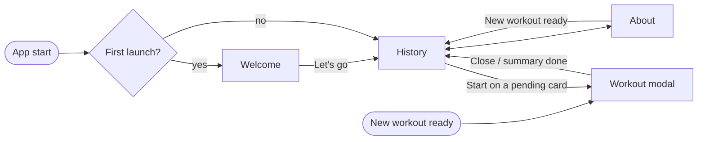

# Screens

Map of the app's screens and how the player moves between them. Each screen's behaviour is specified in its feature note; this note only fixes the structure. Pencil frames follow the names in [[#Frames]].

## Window
- **Desktop**: 1280 × 800 logical pixels by default, like the League client's own window. Meant to be readable from a distance while exercising (big numbers).
- One window. No overlay in the MVP (see [[Vision]]).

## Layout
```
┌────────────────────────────────────┐
│ ⧗ COOLDOWN.LOL ● Connected · Lobby ⚙ⓘ│  top bar
├────────────────────────────────────┤
│                                    │
│              History               │
│        (or Settings / About)          │
│                                    │
│                                    │
└────────────────────────────────────┘
```
- **No sidebar.** **History** is the main screen and takes the full width, with 32 px margins. About and Settings use a 720 px column centred in the window; Welcome a 560 px column centred both ways.
- **Top bar** (52 px), on every screen except Welcome: the Mark and the "COOLDOWN.LOL" wordmark (`.LOL` in `accent`) on the left; on the right the connection dot and client phase (replaces the current [[Client status]] card), a **Settings** button (gear) and an **About** button (ⓘ). The button of the screen being shown is marked with a `border` background and a `text-primary` icon.
- **Settings** and **About** open from the top bar buttons and have a "‹ History" link back. There is no other navigation.
- The window opens on **History**. Navigation never changes on its own.
- **Workout modal**: when a game ends and its workout is ready, a **prompt** opens over History, like a matchmaking "match found" prompt: a centred dialog with a big round **Start workout** button, what is due, and Later / Skip workout (see [[Post-game workout#Prompt ("Workout ready")]]). Once started, the steps open as a **sheet** rising over History: full width, from just under the top bar to the bottom of the window, rounded top corners, header "POST-GAME WORKOUT" and a close button (×). Closing it returns to History. If About is shown when the workout is ready, the app goes back to History first.

## Screens
| Screen | Access | Content | Feature |
|---|---|---|---|
| **Welcome** | first launch only (no top bar) | Shown once, at first launch: the principle (main stat → burpees, secondary stat → squats, deaths → plank), the health warning, Riot's disclaimer, a "Let's go" button | [[First launch]] |
| **History** | main screen, default | All games grouped by session, newest first, one row per game, in a Games view (stats) or a Workouts view (exercises). Also shows the game that just ended while its workout is computed, and games without a workout | [[History]] |
| **Workout** (modal over History) | on its own, or Start on a pending card | Opens on its own when a workout is ready, or from **Start** on a pending card: prompt → steps → summary. All its states are in [[Post-game workout]] | [[Post-game workout]] |
| **Settings** | gear in the top bar | Opt-in error reports: "Send crash reports" and "Send all logs" switches, off by default, and the 30-day retention note; on alpha builds, the update status and **Check now** | [[Settings]], [[Auto-update]] |
| **About** | ⓘ in the top bar | `AboutSlint` (required, see [[ADR-0001 Native UI with Slint]]), Riot's "Legal Jibber Jabber" disclaimer, app version | — |

The computation of every number stays **inline** in each workout step (stat, target, cap) and in an expanded History card: there is no detail screen.

Later (not in the MVP): difficulty and targets in Settings. Unbuilt screens are not shown, not even disabled.



## Frames
In `design/cooldown.pen`, at 1280 × 800 (the installer at 420 × 500). The `App shell / Settings / *` frames lost their content in the move to 1280 × 800: the app keeps the Settings layout of the earlier frames, in the About column. Every screen except Welcome is an instance of the `App shell / Top bar / Default` component with its `Content` slot replaced. Modal frames show the prompt or the sheet over a dimmed copy of `History / Main / Nominal`.

The canvas is a stack of sections, each starting with a `Flow label / …` title: `Foundations` (the `Brand / Logo` and `Foundations` boards), `Primitives`, `Controls`, `Core components`, `History components`, then the screens. History screens are built from the History components: each session is a `Session header / *` instance followed by `Game row / *` instances. Every button, icon button and text link in the screens is an instance of a `Controls` component. Screens are laid out along the user flow: one row per stage, left to right in the order the player sees the screens, with arrows labelled by the action that leads to the next frame ("Let's go", "Start workout", "Close", …).

**Primitives**
| Frame | Shows |
|---|---|
| `Logo / <Mark, Lockup>` | Logo components ([[Brand]]) |
| `Switch / <Off, On>` | On/off switch, reusable components |
| `Exercise icon / <Burpee, Squat, Plank> / <16, 28, 44, 56>` | Exercise pictograms, reusable components (generated in Pencil) |

**Controls** (board `Controls library`)
| Frame | Shows |
|---|---|
| `Button / <Primary, Secondary, Danger>` | 44 px buttons, optional leading icon |
| `Button / Primary / Small` | Inline Start button of a pending game row |
| `Icon button` | 36 px icon button (top bar navigation, dialog close) |
| `Text link` | Text link with optional leading icon (Back, Later) |
| `<component> / <Hover, Pressed, Focus, Disabled>` (+ `Icon button / Selected`) | One reusable instance per state, and the **State rules** table ([[Tokens#Interaction]]) |

**Core components**
| Frame | Shows |
|---|---|
| `App shell / Top bar / Default` | The top bar (Mark, wordmark, connection status, Settings and About buttons) and the `Content` slot, reusable component |
| `Champion portrait` | Played + linked champion placeholder, reusable component ([[Champion portraits]]) |

**History components**
| Frame | Shows |
|---|---|
| `Session header / <Games, Workouts, Workouts / Current>` | Session title, status chips and win/loss count, per History view ([[History#Session summary]]) |
| `Game row / Games / <Pending, Done, Partial, Skipped, No workout, Before cooldown.lol>` | Game row of the Games view: champion, KDA and stat gauges, workout status ([[History#Game rows]]) |
| `Game row / Games / Done expanded` | Same row opened on its details |
| `Game row / Workouts / <Pending, Done, Partial, Skipped>` | Game row of the Workouts view: one column per exercise |
| `Game row / Workouts / <Done, Partial> expanded` | Same rows opened on their details |
| `Game row / Computing` | "Game over · Computing your workout…" row |
| `Stat icon / <Farming, Damage share, Kill participation, Vision, Deaths>` | Stat pictograms used in the game rows |

**1 · First launch → first game**
| Frame | Shows |
|---|---|
| `First launch / Welcome / Default` | Welcome screen |
| `History / Main / Before cooldown.lol` | First opening: sessions of games imported from the client, neutral headers, *Skipped* cards with the computed amounts |
| `History / Main / Computing` | A game just ended: "Game over · Computing your workout…" card on top |

**2 · Post-game workout**
| Frame | Shows |
|---|---|
| `Post-game workout / Modal / Prompt` | "Workout ready" prompt (Mid): big Start workout button, what is due, Later / Skip workout |
| `Post-game workout / Modal / Step reps` | Rep step (squats), number done lowered with − |
| `Post-game workout / Modal / Step plank ready` | Plank step before Start |
| `Post-game workout / Modal / Step plank running` | Countdown running |
| `Post-game workout / Modal / Step plank paused` | Countdown paused |
| `Post-game workout / Modal / Summary` | Done vs. due, status, session total, Close |
| `History / Main / Nominal` | Back on History: current session and an older one, dense game rows |
| `History / Main / Game expanded` | One card opened: stat and target per exercise, game details |

**3 · Variants**
| Frame | Shows |
|---|---|
| `Post-game workout / Modal / Prompt (Support)` | Support variant, with 0 squats (dimmed) |
| `History / Main / No workout` | Remake and role not detected: muted "No workout" cards with the reason |
| `History / Main / Empty` | No game stored yet and none in the client's match history |

**6 · Desktop proposal**
| Frame | Shows |
|---|---|
| `History / Main / <Games, Workouts> view (desktop)` | History in each view ([[History#Views]]) |
| `History / Main / <Games, Workouts> view · Game expanded (desktop)` | A row opened on its details in each view |

**4 · About & Settings**
| Frame | Shows |
|---|---|
| `App shell / About / Default` | About screen |
| `App shell / Settings / Default` | Settings, both switches off |
| `App shell / Settings / Crash reports on` | Settings, "Send crash reports" on |
| `App shell / Settings / Updates checking` | Settings, update check running (Check now disabled) |
| `App shell / Settings / Updates ready` | Settings, a new alpha build installed for the next launch |
| `App shell / Settings / Updates failed` | Settings, the last update check failed |
| `App shell / Settings / Scrolled to the bottom` | Settings scrolled down: Updates, Shortcuts, Startup and Uninstall sections |
| `App shell / Settings / Uninstall confirm` | Settings, confirmation dialog before uninstalling |
| `App shell / Settings / Uninstall failed` | Settings, the uninstaller could not start |

**5 · Installer**
| Frame | Shows |
|---|---|
| `Installer / Window / Options` | Installer: welcome, shortcut and startup choices |
| `Installer / Window / Installing` | Installer: installation in progress |
| `Installer / Window / Done` | Installer: installed, Launch cooldown.lol switch and Finish |
| `Installer / Window / Failed` | Installer: installation failed |

## Open questions
- Can the window be resized, and down to what size?
- Should the window remember its position on screen?
