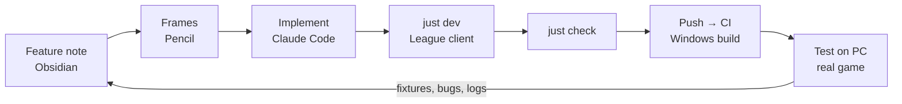

# Development

Daily loop on **macOS**. The Windows PC is only needed for what the Mac can't show (see [[Windows testing]]).

## One-time setup (Mac)
```sh
curl --proto '=https' --tlsv1.2 -sSf https://sh.rustup.rs | sh   # rustup; the toolchain is pinned by rust-toolchain.toml
brew install just
cargo install slint-viewer                                        # optional: live preview of .slint files
volta install node@24                                             # Node, only for commit linting (or brew install node)
just setup                                                        # commitlint, the commit-msg hook and cargo-xwin
```
`rust-toolchain.toml` also installs the `x86_64-pc-windows-msvc` target and `llvm-tools`, used by `just check-windows`. That recipe runs `cargo xwin check`: Velopack depends on `ring`, which compiles C, so the Windows C headers are needed; cargo-xwin downloads Microsoft's CRT and Windows SDK headers once (about 1 GB, under Microsoft's license) into its cache.

Recommended editor extensions are listed in `.vscode/extensions.json` (rust-analyzer, Slint).

## The loop


1. **Spec**: write or update the feature note ([[Spec to code]]).
2. **Design**: frames in Pencil ([[Design with Pencil]]).
3. **Implement** with Claude Code. Its instructions: `CLAUDE.md` (always loaded), `.claude/rules/` (per area, loaded for matching files), `.claude/skills/` (workflows such as `implementing-a-feature`, loaded on demand).
4. **Run** `just dev`: starts the app against the League client running on this Mac (open it and log in first: the app finds its lockfile like on Windows). Closing the window keeps the app running, as on Windows: quit from its icon in the menu bar, or with Ctrl-C in the terminal. See [[Running in the background]].
5. **Iterate on UI** with `just preview <path>` (Slint live reload, fixed data, see [[Previews]]).
6. **Check** with `just check` before committing: format, clippy (pedantic, warnings denied), tests, Windows type-check.
7. **Push** and open a pull request from the template ([[Pull requests]]): CI runs the checks (format, commit messages, clippy and tests on Windows and macOS). To keep them fast, they compile without debug info (`CARGO_PROFILE_DEV_DEBUG=0`: a failing test still says where it panicked, its backtrace has no symbols), and only `main` writes the dependency cache: a pull request reads the cache of `main`, so one that changes `Cargo.lock` compiles the changed dependencies on every push. Add the `build` label to also get release builds of the pull request, linked from a comment. After the merge, `main` is built with its debug symbols uploaded to Sentry, and merged work ships through release-please ([[Releasing]]).
8. **Validate on Windows** when the change touches platform code, overlays or real-client behaviour.

## Useful commands
| Command | What |
|---|---|
| `just dev` | the app against the League client running on this Mac |
| `just preview <path> [story]` | live preview of `ui/<path>.preview.slint` (`screens/history`, `app-window`, …): its gallery or one story |
| `just test` | all tests |
| `just check-windows` | type-check the Windows build |
| `RUST_LOG=trace just dev` | verbose logs |
| `COOLDOWN_DATA_DIR=$(mktemp -d) just dev` | start as on a first launch (welcome screen) |
| `just version` | full version of a build of the checkout (`0.2.0+57.a1b2c3d`, see [[Releasing]]) |
| `just pr-screenshots` | screenshots of the changed UI for the PR body (see [[Pull requests]]) |

## Branches and commits
- `main` is always green in CI.
- Small commits, English, following [Conventional Commits](https://www.conventionalcommits.org): `type(scope): subject`, subject in the imperative and lower case, no trailing period, header up to 100 characters.
  - Types (from `@commitlint/config-conventional`): `feat`, `fix`, `docs`, `style`, `refactor`, `perf`, `test`, `build`, `ci`, `chore`, `revert`.
  - Optional scope, one of: `core`, `lol`, `app`, `ui`, `design`, `docs`, `deps`, `ci`, `tooling`.
  - Examples: `feat(core): add champ select timer state`, `docs(design): sketch the history screen`, `docs: specify the post-game workout`, `ci: lint commit messages`.
  - Breaking change: `feat(lol)!: …` or a `BREAKING CHANGE:` footer.
- Enforced by **commitlint** (`commitlint.config.mjs`): the `commit-msg` hook in `.githooks/` (enabled by `just setup`) and the `commitlint` CI job. Check a message with `just commitlint "feat(core): …"`. Never bypass the hook with `--no-verify`.
